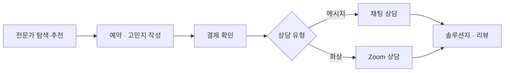
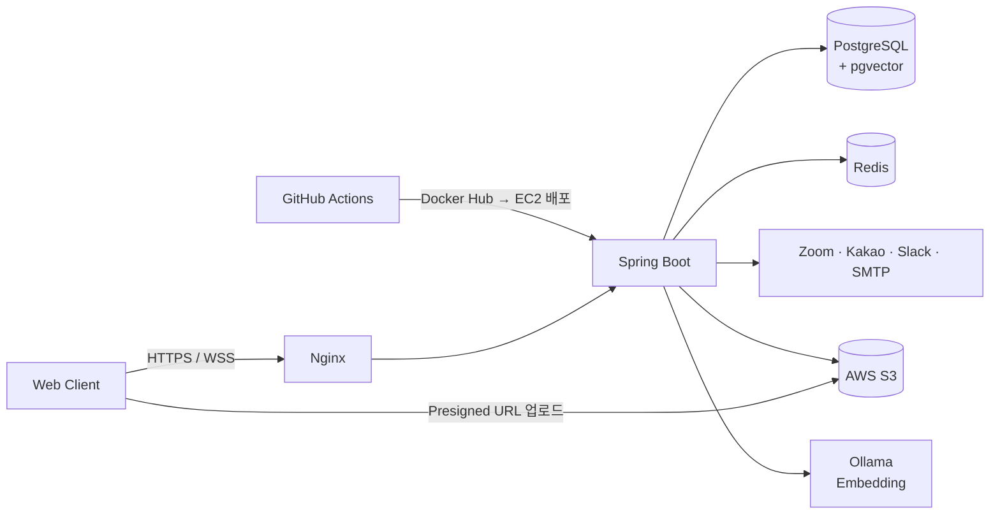

# MENUAL — 남성 그루밍 전문가 1:1 상담 플랫폼 (Backend)

> 헤어·패션 전문가에게 **사진 기반 고민지**를 보내고, **메시지 / 화상(Zoom) 상담**으로 맞춤 솔루션을 받는 서비스

## 1. 프로젝트 소개

남성 그루밍(헤어·패션)에 관심은 있지만 **"나한테 뭐가 어울리는지"** 물어볼 곳이 없는 사용자와 스타일 전문가를 연결하는 플랫폼입니다.
사용자는 사진과 체형·얼굴형·선호 스타일을 담은 **고민지**를 작성해 예약하고, 전문가는 **채팅 또는 Zoom 화상 상담** 후 **솔루션지**를 전달합니다.

 

## 2. 핵심 기능

### ⭐ 화상 상담 프로세스 자동화
- 전문가가 **최초 1회 Zoom OAuth 연동**만 하면, 이후 결제 확정 시 **전문가 계정으로 Zoom 미팅 자동 생성**
- 스케줄러가 **상담 10분 전 채팅방에 참여 링크를 자동 전달**하고, 시작 시각에 상담 상태를 진행 중으로 전환
- Zoom 토큰은 **AES-GCM으로 암호화해 저장**하고, 만료 시 Refresh Token으로 자동 갱신

### ⭐ 이미지 관리
- **S3 Presigned URL**로 클라이언트가 S3에 직접 업로드 (서버 부하 없음)
- 업로드 경로를 **`tmp/` · `final/`로 분리** → 결제가 확정된 상담의 이미지만 `final/`로 이동
- `tmp/`에 **S3 Lifecycle 정책**을 적용해 **미완료 상담 이미지를 7일 후 자동 삭제**

### ⭐ 전문가 추천
- **Spring AI + pgvector**로 전문가 포트폴리오를 임베딩(bge-m3)해 벡터로 저장
- 고객의 **고민지 내용과 포트폴리오 간 의미 유사도**를 계산해 헤어/패션 카테고리별로 적합한 전문가 추천

### ⭐ 실시간 상담 채팅
- **WebSocket(STOMP)** 기반 1:1 채팅으로 메시지 상담 진행
- 연결 시 **쿠키의 JWT로 인증**하고, 결제가 확정되면 채팅방 생성과 고민지 전송이 자동으로 이루어짐
- 채팅방 목록에서 **마지막 메시지와 안 읽은 메시지 수**를 한 번에 조회

### ⭐ 예약 · 결제 관리
- 예약 가능 날짜·시간 조회 후 **임시 예약**을 생성하고, 입금하지 않으면 **스케줄러가 자동 취소**해 시간 슬롯 반환
- 관리자 결제 확인, 예약 취소, 환불 요청·승인까지 **예약 상태 흐름** 관리
- **포인트 사용·적립·환불**과 결제·환불 등 주요 이벤트의 **Slack 알림**

### ⭐ 전문가 탐색
- **QueryDSL**로 평점 평균·리뷰 수를 집계해 카테고리별 **인기 전문가 랭킹**과 목록 제공
- 전문가 상세(포트폴리오·리뷰), 찜, 실시간·베스트 후기 조회

### 그 외 기능

| 구분 | 기능 |
|---|---|
| 회원 | 이메일 인증 회원가입, 카카오 로그인, JWT(Cookie) 인증, 전문가 전환, 회원 탈퇴 |
| 전문가 | 포트폴리오(Before/After) 관리, 상담 유형·가격·일정 관리 |
| 상담 | 헤어/패션 고민지 작성, 솔루션지(텍스트+이미지) 작성 |
| 리뷰 | 상담 완료 후 리뷰 작성(이미지·해시태그), 리뷰 작성 시 포인트 적립 |
| 운영 | 관리자 권한(RBAC) |

 

## 3. 기술 스택

| 분류 | 기술 |
|---|---|
| Backend | Java 21, Spring Boot 3.5, Spring Security, Spring Data JPA, QueryDSL |
| AI | Spring AI, Ollama(bge-m3 Embedding), pgvector |
| Realtime | WebSocket, STOMP, SockJS |
| Database | PostgreSQL, Redis |
| Storage | AWS S3 (Presigned URL, Lifecycle) |
| External API | Zoom OAuth / Meeting API, Kakao OAuth, SMTP, Slack Webhook |
| Infra | AWS EC2, Docker Compose, Nginx, GitHub Actions |

 

## 4. 시스템 아키텍처

- `develop`/`main` push 시 GitHub Actions가 빌드 → Docker 이미지 push → EC2에서 `docker compose`로 자동 배포

 

## 5. 역할 분담

| 이름 | 담당 |
|---|---|
| [@danaggero](https://github.com/danaggero) | 로그인 · JWT 인증, WebSocket 채팅, 예약 · 결제 · 환불, 스케줄러, CI/CD · 인프라(Docker, Nginx) |
| [@mirupio](https://github.com/mirupio) | Zoom 연동 · 화상 상담 자동화, S3 이미지 관리, 전문가 추천(Spring AI), 관리자 결제 확인, 고민지 · 솔루션지 · 포트폴리오 |

